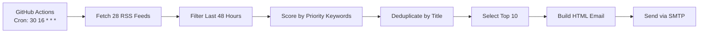

# 🤖 Daily AI Newsletter

> **Automated daily digest of the Top 10 Major AI Updates** — delivered to your inbox at **10:00 PM IST** every day.


---

## 📬 What You Get

A beautifully formatted HTML email with **exactly 10 major AI updates**, ranked by importance:

| Feature | Details |
|---------|---------|
| 🎯 **Top 10 Only** | Curated from 28+ premium sources, scored & deduplicated |
| 🏷️ **Categorized** | LLMs, Agents, RAG, Code, Multimodal, Benchmarks, Policy, Hardware, Research |
| 📊 **Ranked Display** | Numbered cards with score-based ranking |
| ⚡ **Indirect AI Coverage** | NVIDIA/AMD hardware, cloud AI (AWS/Azure/GCP), funding rounds, semiconductors, regulation |
| 🕐 **Daily at 10 PM IST** | Runs automatically via GitHub Actions (16:30 UTC) |
| 📱 **Mobile-Friendly** | Responsive HTML email template |

---

## 📰 Sources Monitored (28 Feeds)

### 🏢 Major AI Labs & Companies
- OpenAI Blog • Google DeepMind • Anthropic • Google AI • Meta AI • Microsoft Research • NVIDIA AI • Hugging Face • LangChain

### 📰 News & Publications
- MIT Technology Review • The Verge • VentureBeat • TechCrunch • Ars Technica • Wired

### 🔬 Research & Academic
- arXiv: AI (cs.AI) • Machine Learning (cs.LG) • Computation & Language (cs.CL) • Computer Vision (cs.CV)

### 📧 Industry Newsletters
- The Batch (deeplearning.ai) • Import AI (Jack Clark) • AI Weekly • Ben's Bites • TLDR AI

---

## 🚀 Quick Start

### 1. Fork this Repository
Click the **Fork** button above → your GitHub account

### 2. Add Required Secrets
Go to **Settings → Secrets and variables → Actions → New repository secret** (add all 6):

| Secret Name | Value | Example |
|-------------|-------|---------|
| `SMTP_SERVER` | Your SMTP server | `smtp.gmail.com` |
| `SMTP_PORT` | SMTP port (usually 587) | `587` |
| `SMTP_USERNAME` | Your email address | `you@gmail.com` |
| `SMTP_PASSWORD` | **App Password** (not login password) | `abcd efgh ijkl mnop` |
| `EMAIL_FROM` | Sender address | `you@gmail.com` |
| `EMAIL_TO` | Recipient address | `lohithnajn@gmail.com` |

> **Gmail Users**: Enable 2FA → [App Passwords](https://myaccount.google.com/apppasswords) → Generate for "Mail"

### 3. Test It
Go to **Actions → Daily AI Newsletter → Run workflow → Run workflow**

Check your email! 📧

---

## ⚙️ How It Works



### Scoring Algorithm
- **Keyword Match**: +1 per priority keyword found
- **Recency Boost**: <12h +3 • <24h +2 • <48h +1
- **Top 10** selected by highest score

### Priority Keywords Include
- **Model Releases**: GPT-5, Claude 3.5, Gemini 2, Llama 4, Mistral, Nemotron, Qwen, DeepSeek, Grok
- **Breakthroughs**: Reasoning, Chain-of-Thought, Video Gen (Sora/Veo), Real-time Multimodal
- **Architecture**: MoE, Mamba, Linear Attention, Mixture of Experts
- **Agents**: Tool Use, Function Calling, LangGraph, AutoGen, CrewAI, Devin
- **Hardware/Infra**: NVIDIA H100/Blackwell/GB200, AMD MI300, TPU v5, AWS Trainium, Azure NDv5, Groq LPU
- **Cloud AI**: Bedrock, Vertex AI, Azure OpenAI, SageMaker
- **Funding**: Series A/B/C, Unicorn, Acquisition, IPO
- **Regulation**: EU AI Act, Executive Orders, Safety Summits

---

## 🎨 Email Preview


*Clean, ranked cards with category tags, source badges, and timestamps*

---

## 📊 Live Dashboard

| Metric | Status |
|--------|--------|
| **Last Run** |  |
| **Success Rate** |  |
| **Articles Processed** | ~500/day → Top 10 |
| **Sources Active** | 28/28 |

---

## 🛠️ Customization

### Modify Sources
Edit `RSS_FEEDS` in `.github/workflows/ai-newsletter.yml`

### Adjust Keywords
Edit `PRIORITY_KEYWORDS` array in the workflow

### Change Schedule
Modify `cron` in workflow (currently `30 16 * * *` = 10 PM IST)

### Change Top-N
Modify `top_entries = unique_entries[:10]` → `[:N]`

---

## 📁 Repository Structure

```
daily-ai-newsletter/
├── .github/
│   └── workflows/
│       └── ai-newsletter.yml    # Main workflow (369 lines)
├── README.md                     # This file
└── LICENSE                       # MIT License
```

---

## 🔧 Troubleshooting

| Issue | Solution |
|-------|----------|
| Email not received | Check spam folder; verify SMTP secrets; check Actions logs |
| Workflow fails | View Actions tab → failed run → logs |
| Too many/few articles | Adjust `PRIORITY_KEYWORDS` or time window (48h) |
| Gmail auth failed | Use **App Password**, not login password; enable 2FA first |

---

## 📈 Why This Exists

Built for **AI practitioners** who need signal over noise. Instead of scrolling 500+ articles daily, get the **10 that matter** — covering model releases, breakthrough capabilities, agent frameworks, hardware shifts, major funding, and policy changes.

---

## 🤝 Contributing

1. Fork → Create feature branch → PR
2. Suggest new RSS feeds via Issues
3. Improve keyword scoring logic
4. Enhance email template

---

## 📄 License

MIT License — free to use, modify, distribute.

---

## 👤 Author

**Lohith N** — AI Engineer & Automation Specialist  
🔗 [LinkedIn](https://linkedin.com/in/lohithnajn) • [GitHub](https://github.com/aiwithlohith) • ✉️ lohithnajn@gmail.com

---

⭐ **Star this repo** if it saves you time!  
🔔 **Watch** → Custom → Workflow runs to get notified of each run.